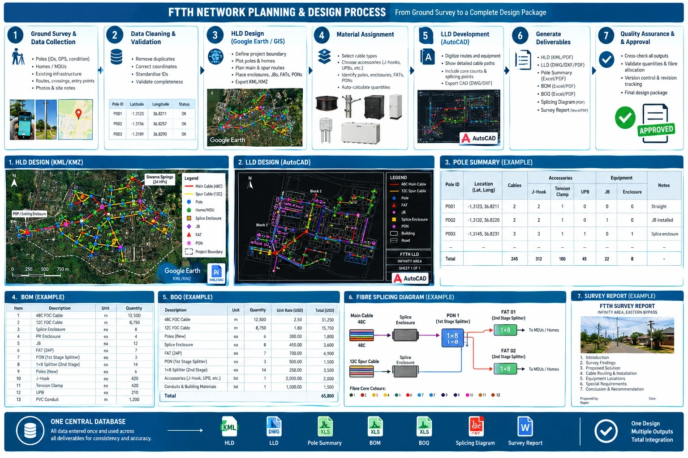

# FTTH NETWORK PLANNING AND DESIGN SYSTEM
## Workflow Explanation and Application Requirements

### 1. Purpose of the System

The proposed application will streamline the FTTH network planning and design process, from ground-survey data collection to the production of final engineering deliverables. It will centralise surveyed data, network planning, fibre allocation, infrastructure quantities, and documentation within one system.

The system should allow a planner to upload or enter survey data, design a proposed fibre network, assign network components, and automatically generate the required design files and reports. All deliverables must use the same approved design data to minimise inconsistencies, reduce manual work, and improve design accuracy.

### 2. Step-by-Step FTTH Network Planning Workflow

#### Step 1: Ground Survey and Data Collection

The process begins with a physical ground survey of the target area. The survey team identifies and records:

- Existing utility poles, including pole IDs, GPS coordinates, pole types, and conditions.
- Homes, residential estates, apartments, and other potential homepasses.
- Existing fibre infrastructure, including cables, enclosures, junction boxes, FATs, and PON connection points.
- Proposed cable routes, road crossings, corners, aerial spans, and building entry points.
- Customer or building details, unit counts, access restrictions, and special installation requirements.

**System requirement:** The application should allow users to import survey data from Excel or CSV files, KML/KMZ files, and GPS or survey applications. It should also allow manual data entry and map-based editing.

#### Step 2: Data Cleaning and Validation

After the survey, the collected data must be cleaned before network planning begins.

This involves removing duplicate poles and homes, correcting missing or inaccurate coordinates, standardising IDs, checking the alignment of surveyed features, and confirming that pole and homepass information is complete.

The planner should distinguish between existing infrastructure, surveyed features, and proposed infrastructure.

**System requirement:** The application should flag duplicate IDs, missing coordinates, invalid data, and potential inconsistencies. It should allow the planner to correct errors before approving the survey dataset for design.

#### Step 3: HLD Planning in Google Earth or an Integrated GIS Map

Once the survey data has been cleaned, the planner uses Google Earth or a GIS mapping environment to develop the High-Level Design (HLD).

The planner establishes the overall network topology by:

1. Defining the project boundary and scope.
2. Plotting the surveyed poles and homepasses.
3. Selecting the proposed network starting point, such as the POP, existing enclosure, or designated interception point.
4. Planning the main feeder or distribution cable route.
5. Planning spur cables to serve the designated streets, estates, and MDUs.
6. Identifying proposed poles, splice enclosures, junction boxes (JBs), FATs, and PON locations.
7. Assigning cable sizes and identifying the intended network distribution paths.

The completed HLD is saved and exported in KML/KMZ format for viewing in Google Earth and sharing with survey, rollout, and implementation teams.

**System requirement:** The application should provide a map interface for drawing cable routes, placing network components, assigning IDs, and linking homes to their proposed serving points. It should support KML/KMZ export and import.

#### Step 4: Infrastructure and Material Assignment

Once the HLD route is established, the planner identifies the materials required to construct the network.

The material catalogue should include:

- **Cable and network components:** Fibre optic cables of different core counts, splice enclosures, PR enclosures, JBs, FATs, PONs, and splitters.
- **Pole and aerial accessories:** J-hooks, tension clamps, universal pole brackets (UPBs), extension arms, and poles where required.
- **Building installation materials:** PVC conduits, flexible ducts, cable supports, and other accessories required by the proposed route.
- **Additional construction materials:** Road-crossing protection, ducting, manholes, and other items where applicable.

Material selection must be based on the actual route, installation method, pole configuration, cable type, and company standards.

**System requirement:** Each network component should have a defined material list, unit of measurement, quantity rules, and applicable installation conditions. The application should calculate material quantities from the approved design and allow authorised manual adjustments.

#### Step 5: LLD Development in AutoCAD or an Integrated CAD Environment

After the HLD is established, the planner develops the Low-Level Design (LLD) using AutoCAD or a suitable integrated design environment.

The LLD translates the high-level network plan into detailed construction information. It should show the specific pole-to-pole routes, cable paths, equipment locations, cable core counts, splice points, FAT positions, building entry routes, and relevant installation details.

The LLD should be consistent with the HLD and include sufficient information for the construction team to implement the proposed network.

**System requirement:** The application should support CAD-compatible exports, such as DXF, and structured design data that can be used in AutoCAD. Where direct DWG generation is not supported, the system should provide a reliable export or integration workflow rather than claiming to generate native DWG files automatically.

#### Step 6: Pole Summary Generation

The pole summary provides a pole-by-pole breakdown of the infrastructure and accessories required along the designed route.

For each pole, the system should identify:

- Pole ID and location.
- Cable route and number of cables passing through the pole.
- J-hooks, tension clamps, UPBs, and other required accessories.
- Crossings, corners, changes in direction, and special support requirements.
- Proposed JBs, enclosures, or other equipment mounted at the pole.
- Any special installation notes.

The system should calculate quantities using the applicable construction standards and the actual configuration of each pole.

**Output:** A structured pole summary in Excel and PDF formats.

#### Step 7: BOM and BOQ Generation

The Bill of Materials (BOM) and Bill of Quantities (BOQ) are produced from the approved HLD and LLD.

The BOM lists the materials and equipment required for the design, while the BOQ provides the measured quantities needed for construction and, where applicable, cost estimation.

The system should calculate:

- Fibre cable lengths by cable type and core count.
- Pole accessories and mounting hardware.
- Poles, JBs, splice enclosures, FATs, PONs, and splitters.
- Conduits, ducts, and other building installation materials.
- Other approved construction items.
- Optional unit rates and total costs where pricing is available.

Cable quantities should account for the designed route, applicable slack allowances, vertical runs, building entries, and other approved installation allowances. Material quantities should be derived from the design rules and verified before final approval.

**Outputs:** BOM and BOQ in Excel and PDF formats.

#### Step 8: Fibre Splicing Diagram

The splicing diagram explains how the fibre cores are connected and distributed throughout the network.

The planner assigns cable cores at each enclosure, determines which fibres continue along the main route or branch into spur cables, and specifies the intended connections to PONs, splitters, and FATs.

The diagram should show:

- Cable IDs and core counts.
- Individual fibre core allocation and colour identification.
- Splice enclosures and splice points.
- PON assignments and first-stage splitter configurations.
- FAT IDs and second-stage splitter configurations.
- Incoming and outgoing cable connections.
- Used, spare, and reserved fibre cores.

The system must check that fibre allocation is consistent with the capacity of each cable and the selected network topology.

**System requirement:** The application should provide a visual splicing editor that allows the planner to assign cores, create splice connections, and generate a clear diagram for implementation. It should flag duplicate assignments, unavailable cores, and invalid connections.

#### Step 9: Survey Report Generation

The application should generate a professional survey report using the verified survey findings and proposed design.

The report should include:

1. Project title and introduction.
2. Survey findings and existing infrastructure.
3. Proposed network solution.
4. Cable routing and installation requirements.
5. Proposed equipment locations and configurations.
6. Special construction requirements and access restrictions.
7. Conclusion and recommendations.
8. Survey photographs with captions, where provided.

The report should use the actual project information and avoid inventing details that were not recorded during the survey.

**Outputs:** Editable Word document and PDF.

#### Step 10: Quality Assurance, Approval, and Final Export

Before the design package is issued, the system should perform consistency checks across all deliverables.

These checks should confirm that the HLD, LLD, pole summary, BOM, BOQ, splicing diagram, and survey report use consistent project IDs, cable IDs, equipment IDs, quantities, and network configurations.

The planner should be able to review, amend, and approve the design before generating the final package.

The application should maintain design versions, revision dates, approval status, and change records so that subsequent amendments can be tracked.

### 3. Required System Outputs

| Deliverable | Required output |
|---|---|
| HLD | KML/KMZ and PDF |
| LLD | CAD-compatible file, preferably DWG/DXF, and PDF |
| Pole summary | Excel and PDF |
| BOM | Excel and PDF |
| BOQ | Excel and PDF |
| Splicing diagram | PDF and editable diagram data |
| Survey report | Word and PDF |
| Project data | Excel/CSV and structured project database |

### 4. How the Application Should Work

The central principle is **enter the design information once and reuse it across every deliverable**.

For example, if the planner changes a cable route, the system should update the route length and flag affected material quantities. If a FAT is relocated, the HLD, LLD, equipment schedule, and splicing documentation should reflect the approved change. The system should identify which outputs need to be regenerated rather than leaving conflicting versions in circulation.

The application should include the following main modules:

1. Project and survey data management.
2. GIS map and HLD design.
3. Network topology and equipment allocation.
4. CAD/LLD support.
5. Pole summary and material calculations.
6. BOM and BOQ generation.
7. Fibre core allocation and splicing diagrams.
8. Survey report and photo documentation.
9. Quality assurance, approval, and version control.
10. Export and final design-package generation.

### 5. Recommended Development Approach

The application should be developed in stages to make it practical and manageable.

**Phase 1 — Survey data and HLD:** Import survey data, clean coordinates, display poles and homes on a map, draw routes, assign cable sizes, and export KML/KMZ.

**Phase 2 — Materials and quantities:** Build the material catalogue, define calculation rules, and generate the pole summary, BOM, and BOQ.

**Phase 3 — LLD and splicing:** Add detailed network topology, CAD-compatible exports, fibre core allocation, splitter configuration, and splicing diagrams.

**Phase 4 — Reporting and automation:** Generate survey reports, consolidate all outputs, run cross-document validation, and introduce approval and revision management.

The application should be tested against completed FTTH projects to validate its cable-length calculations, material quantities, fibre allocation, and exported deliverables before it is relied upon for production design.

## Final Objective

The goal is to create a practical FTTH engineering platform that converts ground-survey information into a coordinated, traceable, and implementation-ready design package. It should reduce repetitive drafting and data entry while preserving the planner's control over network topology, technical decisions, material selection, and final approval.
